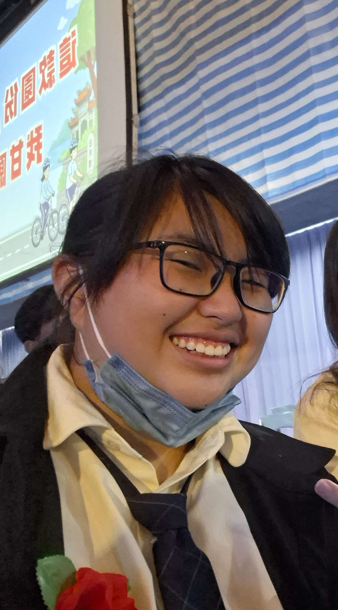
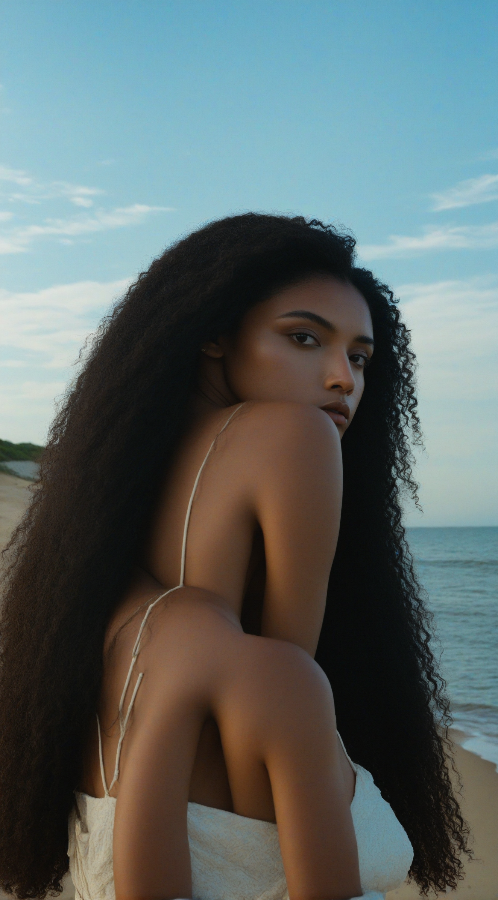
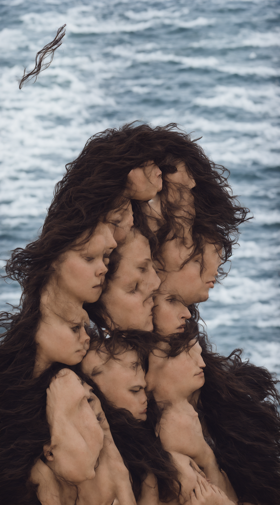

#  原圖

# 生成的圖

# 完整工作流截圖

# 正反提示詞
## 正面:
-A candid photograph of person from the original image with a completely natural, neutral, non-smiling expression,masterpiece,a natural shoreline, and a natural, expansive sky in the background. Natural outdoor lighting, shot on a 35mm lens, high-quality, cinematic, natural skin and hair textures.
## 反面:
-smiling, laughing, showing teeth, grin, joyful expression, short hair, indoor background, indoor setting, artificial studio lighting, cartoon, illustration, drawing, CGI, blurry, distorted, extra limbs, bad proportions, oversaturated, text, watermark, signature, deformed.
# 個人心得
好難，而且感覺做到電腦快燒起來了，還有不知道為什麼我最後變捲髮拉丁裔的樣子，不過整體還是挺好玩的，打破我對ai生圖的一些偏見，中間也生出不少掉理智值的東西。

▲像這個，根本恐怖遊戲會出現的東西。